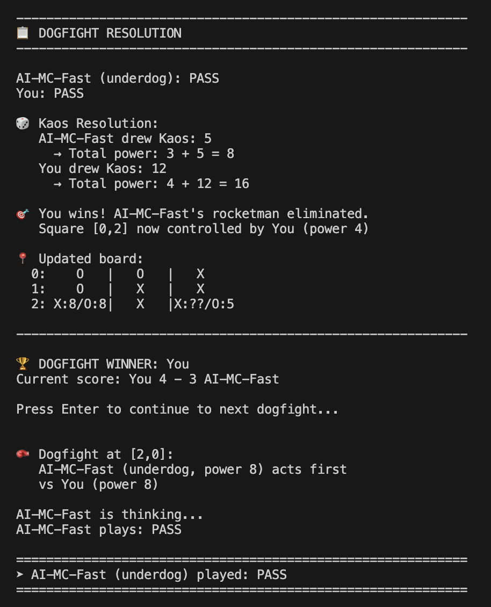
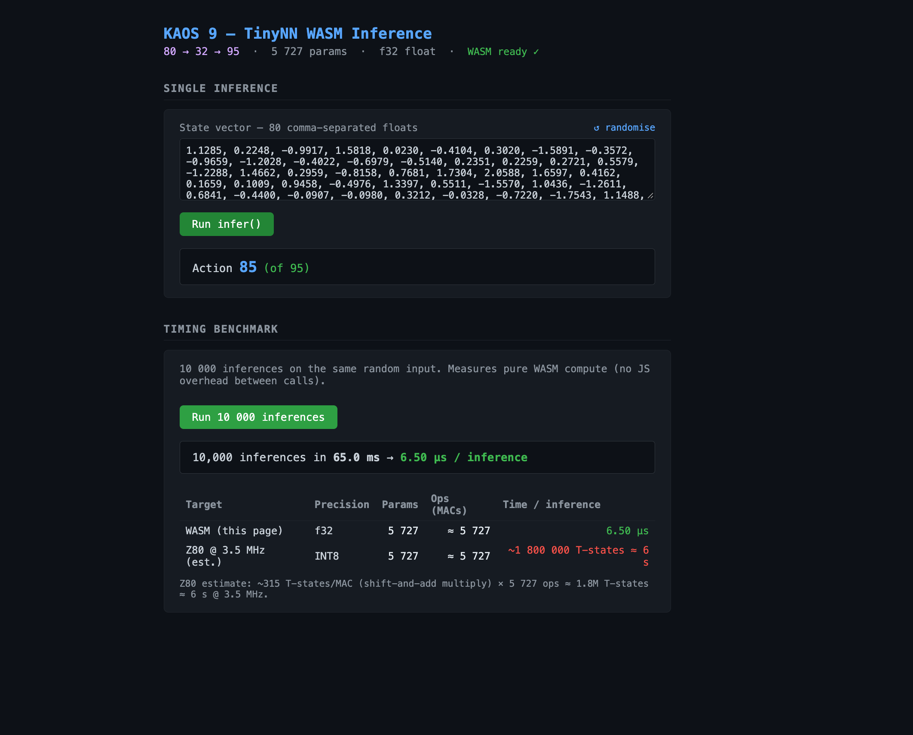
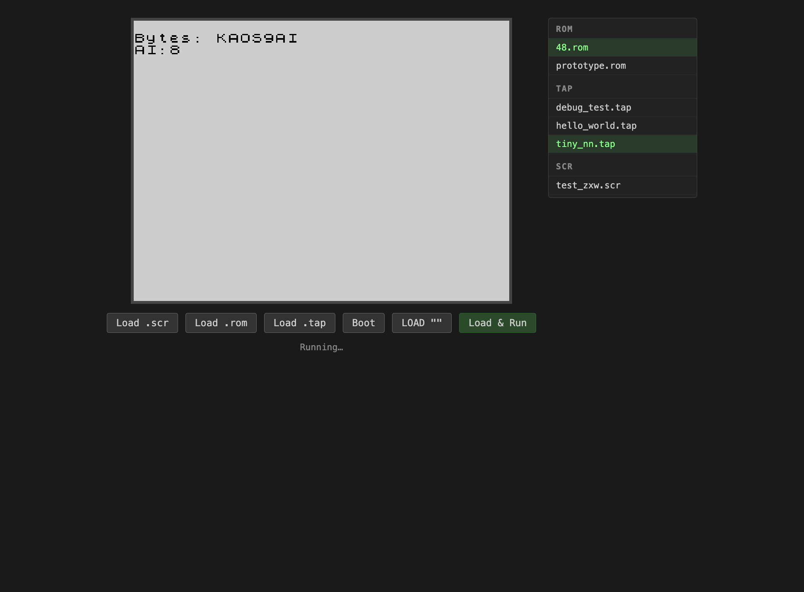

# utala: kaos 9 — AI Research

A study of learning algorithms through a 2-player tactical card game. Five phases of progressively sophisticated agents — from random baseline to a neural network that beats expert heuristics and ships to mobile.

Everything is text-based, inspectable, and hackable.



## Results

**TinyNN v2 wins 54% against the hand-crafted heuristic** — the first learned agent to consistently beat the baseline. 5,727 parameters. 0.045ms inference. Runs pure Dart in the Flutter app, no ML framework on device.

| Phase | Method | vs Heuristic | Ships? |
|-------|--------|-------------|--------|
| 1 | Heuristic (baseline) | 50% | Candidate |
| 2 | TD-Linear (27 features) | 47.5% best | Candidate |
| 3 | TinyNN imitation (from MC) | 48% | — |
| 4 | DQN v3, Variant A | 56% peak | — |
| 5 | **TinyNN v2 distilled** | **54%** | **✅ Flutter** |

All five phases complete. The distilled student (5,727 params) outperforms its 39,135-parameter DQN teacher — averaging out the teacher's training noise preserves strategy and discards oscillation.

## One brain, three runtimes

The same trained TinyNN deploys to three targets — mobile, browser, and a 1982 home computer.

| Target | Precision | Inference | Binary |
|--------|-----------|-----------|--------|
| **Flutter** (ONNX/JSON) | float32 | sub-ms | 25 KB JSON |
| **WASM** (browser) | float32 | 6.5 µs | `.wasm` module |
| **Z80** (ZX Spectrum) | INT8 | ~6 s @ 3.5 MHz | 6,435 bytes |

INT8 quantisation on the Z80 achieves **100% argmax agreement** with the float32 reference — the 8-bit CPU makes the same decisions as the modern runtime.





Full write-up: [One Brain, Three Runtimes](docs/DISTILLATION_TARGETS.md)

## Quick start

```bash
./setup.sh          # Python 3.11 venv + deps
./run.sh            # play as human vs AI
python run_tests.py # run tests
```

## Key commands

```bash
# Train
python scripts/train/variant_a/train_dqn.py
python scripts/train/variant_a/distill_dqn.py

# Evaluate
python scripts/eval/run_evaluation.py

# Export
python scripts/export/export_onnx_phase5.py
```

## Learn

- Project log (phases, decisions, results): [LOG.md](LOG.md)
- Full command reference: [DOCS.md](DOCS.md)
- Project-specific explainers: [explainers/](explainers/README.md)
- Shared concept explainers: [../../explainers/](../../explainers/README.md)
- Game rules: [utala-kaos-9.md](utala-kaos-9.md)
