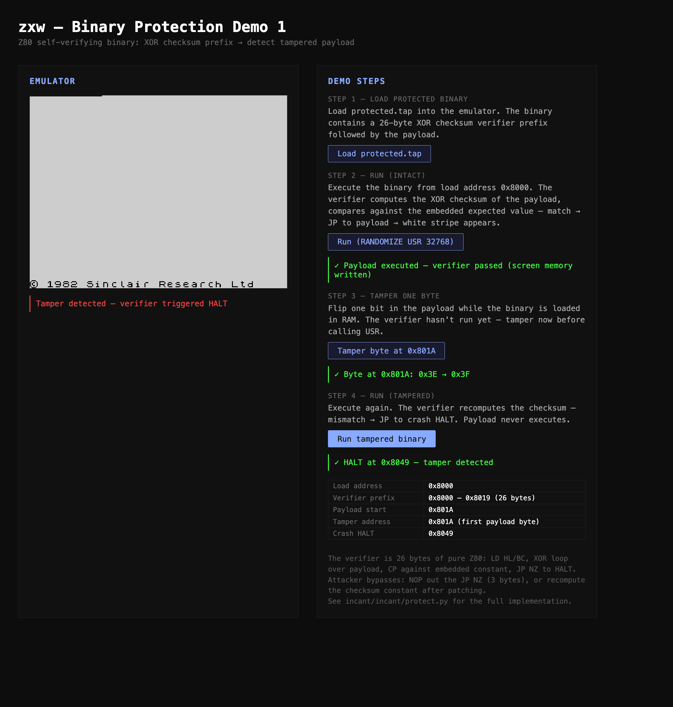
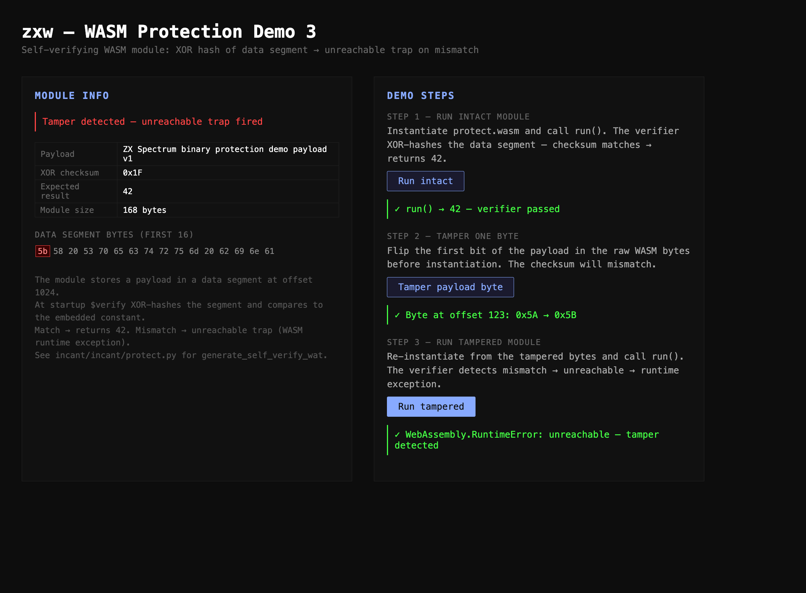

# Binary Protection Demos

Two live demos showing incant's self-verifying binaries — one Z80, one WASM. Both follow the same idea: embed a checksum in the binary, recompute it at runtime, halt/trap if it mismatches.

---

## Demo 1 — Z80 self-verifying binary on zxw

**File:** `zxw/www/demo-protection.html`  
**Screenshot:** [demo1-complete.png](demo1-complete.png)



### What it shows

A 74-byte Z80 binary loaded into the zxw Spectrum emulator at address `0x8000`. The binary has two parts:

- **Verifier prefix (26 bytes, 0x8000–0x8019):** pure Z80 that XOR-hashes the payload and compares to an embedded expected value. Match → JP to payload. Mismatch → JP to crash HALT at `0x8049`.
- **Payload (47 bytes, 0x801A–0x8048):** writes `0xFF` to 9 consecutive screen bytes at `0x4000` (white stripe), then loops.
- **Crash HALT (1 byte, 0x8049):** target of the failed-verification jump.

### The verifier in Z80

```z80
LD HL, payload_start    ; start of payload
LD BC, payload_len      ; byte count
LD D, 0x00              ; accumulator
.loop:
LD A, (HL)              ; load byte
XOR D                   ; XOR into accumulator
LD D, A
INC HL
DEC BC
LD A, B
OR C
JR NZ, .loop            ; loop until BC = 0
LD A, D                 ; compare checksum
CP expected_checksum
JP NZ, crash_halt       ; mismatch → halt
; fall through → payload
```

The expected checksum is computed by `wrap_z80_checksum()` in `incant/incant/protect.py` when the binary is built.

### Demo flow

1. **Load** — binary written directly into emulator RAM at `0x8000` via `emu.write_memory()`
2. **Run (intact)** — `set_pc(0x8000)` → verifier runs → checksum matches → payload writes white stripe to `0x4000`
3. **Tamper** — `emu.write_memory(0x801A, [byte ^ 0x01])` flips one bit in the payload
4. **Run (tampered)** — verifier recomputes, mismatch → `JP NZ 0x8049` → CPU halts

### Attacker bypasses

The verifier is intentionally weak — it's a demo. Two obvious bypasses:

- **NOP the branch:** patch 3 bytes at `0x8018` (`JP NZ` = `C2 49 80`) to `NOP NOP NOP`. Verifier runs but never takes the failure path.
- **Fix the constant:** find the `CP n` at `0x8015`, rewrite `n` to match the new checksum after patching the payload.

Real protection needs more: multiple interleaved checksums, obfuscated constants, anti-debug checks.

### How to regenerate the binary

```bash
cd incant
source .venv/bin/activate
python scripts/make_protected_tap.py
# → zxw/www/tap/protected.tap (74 bytes)
```

---

## Demo 3 — WASM self-verifying module

**File:** `zxw/www/demo-wasm-protect.html`  
**Screenshot:** [demo3-complete.png](demo3-complete.png)



### What it shows

A 168-byte WASM module (`protect.wasm`) that checks its own data segment before running. The module has one export: `run() → i32`. Intact it returns 42. Tamper any byte in the payload and it throws `WebAssembly.RuntimeError: unreachable`.

### The module structure

```wat
(module
  (memory (export "memory") 1)
  (data (i32.const 1024) "ZX Spectrum binary protection demo payload v1")

  (func $verify (result i32)
    ;; XOR-hash bytes 1024..1024+45, return checksum
    ...
  )

  (func (export "run") (result i32)
    (if (result i32) (i32.ne (call $verify) (i32.const 0x1F))
      (then (unreachable))      ;; mismatch → trap
      (else (i32.const 42))     ;; match → return 42
    )
  )
)
```

The expected checksum (`0x1F`) is the XOR of all payload bytes. It's hardcoded in the WAT source by `generate_self_verify_wat()`.

### Demo flow

1. **Run intact** — `WebAssembly.instantiate(bytes)` → `run()` → `42`
2. **Tamper** — flip bit 0 of byte at offset 123 in the raw WASM (`5A` → `5B`, the `Z` in `ZX Spectrum`)
3. **Run tampered** — re-instantiate from tampered bytes → `run()` → `WebAssembly.RuntimeError: unreachable`

The tamper happens in JS before instantiation — the original bytes are untouched, the tampered copy is thrown away after the demo.

### Key difference from Demo 1

In Z80, verification failure jumps to a `HALT` — a soft stop in a CPU. The emulator can detect and display it.

In WASM, `unreachable` is a trap — the runtime aborts execution and throws a JavaScript exception. No graceful fallback. Any `try/catch` around `run()` catches it, but the module's internal state is gone.

### Bypass

Same fundamental weakness: the expected checksum constant (`0x1F`) is visible in the WAT/WASM binary. An attacker can patch it to match their modified payload. Stronger approaches:
- Split the expected value across multiple constants combined at runtime
- Tie the check result into the return value calculation rather than as a guard

### How to regenerate the module

```bash
cd incant
source .venv/bin/activate
python scripts/make_protected_wasm.py
# → zxw/www/protect.wasm (168 bytes)
```

Requires `wat2wasm` (`brew install wabt`).

---

## What this connects to

Both demos run on infrastructure from the zxw and incant projects:

- **zxw** provides the WASM Spectrum emulator API (`set_pc`, `get_pc`, `write_memory`, `read_memory`, `run_until_halt`)
- **incant** provides the protection generators (`wrap_z80_checksum`, `generate_self_verify_wat`, `assemble_wat`)

In a production setting this maps to software licensing, binary integrity checks, and tamper-evident config — the same XOR-hash pattern appears in embedded firmware and DRM schemes.
